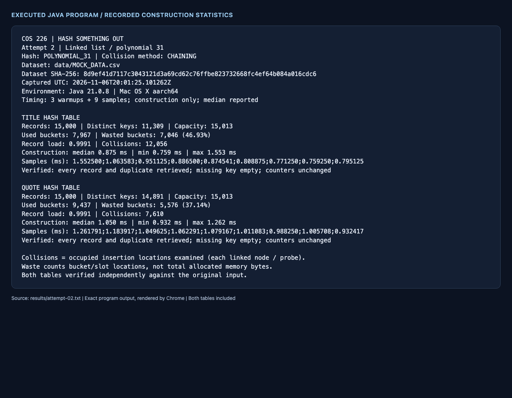
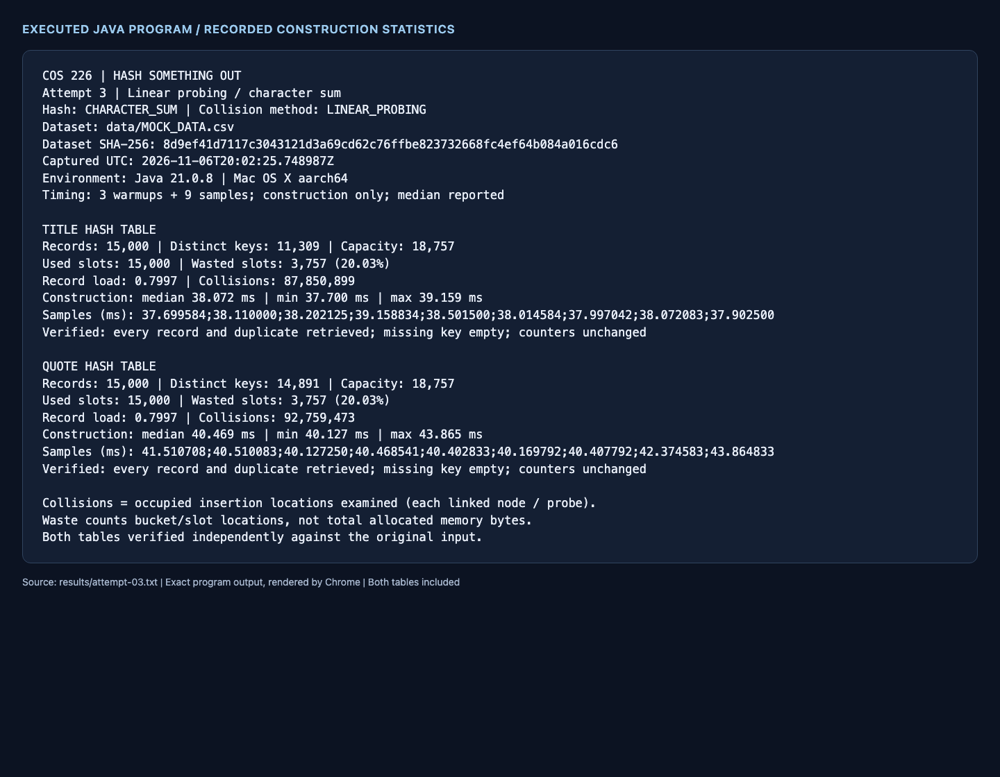
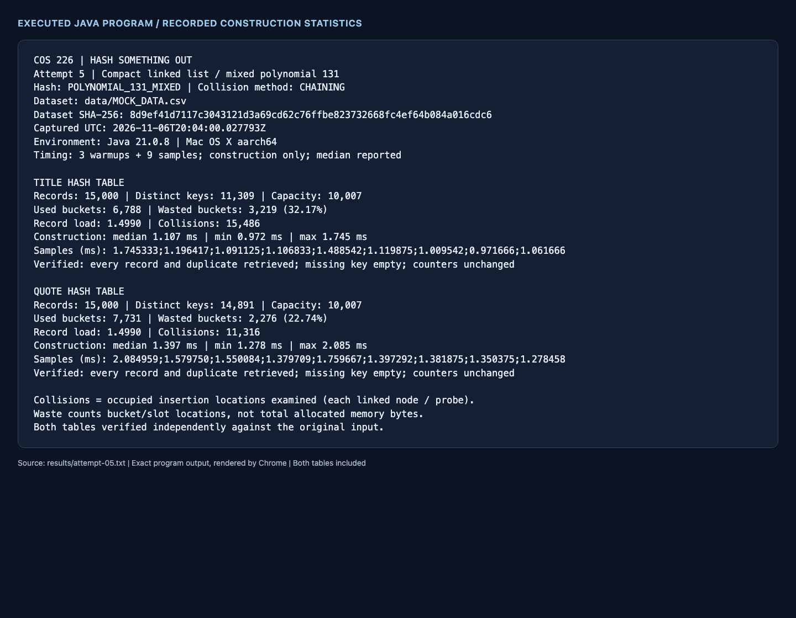

# COS 226: Hash something out

Two custom hash tables store the supplied fake movie records: one uses movie titles
as keys, and the other uses movie quotes. Each experiment is implemented, tested,
measured and committed before the next experiment is added.

## Build, test and run

Requires a JDK 21 or newer. There are no third-party Java dependencies.

```bash
bash scripts/test.sh
bash scripts/run.sh
bash scripts/run.sh --attempt 1 --output build/my-results
bash scripts/run.sh --attempt 1 --title 'Nothing Left to Fear' --quote 'Ergonomic exuding task-force'
```

Run `bash scripts/run.sh --help` for all options. Saved historical evidence lives in
`results/`; use another output directory when collecting new measurements.

## Input and correctness

`data/MOCK_DATA.csv` is the provided input, copied byte for byte. It contains 15,000
records, 11,309 distinct titles and 14,891 distinct quotes. Its SHA-256 is
`8d9ef41d7117c3043121d3a69cd62c76ffbe823732668fc4ef64b084a016cdc6`.
CSV parsing supports quoted commas, doubled quotes, multiline quoted fields,
Unicode, a BOM, trailing empty fields and common line endings. Empty keys are valid;
whitespace and case are preserved. Malformed records produce an actionable error.

Both tables are **multimaps**: each row is stored separately, and `getAll(key)` returns
every matching record in input order. Duplicate titles and quotes are not discarded.
Every experiment verifies all input records against an independent Java `HashMap`
oracle outside the construction timer. The custom tables do not use library maps
for their own storage. Lookups also check a missing key and preserve insertion counters.

## Measurement definitions

- A collision is **each occupied location examined during insertion**. Linked-list
  insertion walks to the tail and counts every existing node. Linear probing counts
  each occupied array slot inspected. Duplicate-key records count in the same way.
- Wasted space is the number and percentage of unused bucket references or array
  slots. Linked nodes and object overhead are additional memory; these counts do
  not claim to measure total bytes.
- Capacity is chosen from the number of records. Prime-capacity calculation,
  array/node allocation, hashing and insertion are timed with `System.nanoTime()`; CSV loading,
  verification, printing and file output are excluded.
- Each table receives three warmup builds and nine measured builds in a single JVM.
  The median, minimum, maximum and all samples are retained. Timing varies with JVM
  compilation, allocation, garbage collection and machine activity; deterministic
  collision and waste counts provide the stronger comparison.

## Experiments and reflection

### 1. Linked list with length-only hashing

Length is a deliberately weak starting point because it ignores every character's
value and order. With 15,013 buckets, titles occupy only 107 buckets and quotes only
46. The tables waste 14,906 (99.29%) and 14,967 (99.69%) buckets, respectively.
Tail insertion causes 3,306,746 title collisions and 5,748,572 quote collisions.
Median construction takes 11.988 ms for titles and 20.873 ms for quotes.
The larger quote collision count agrees with its slower construction, despite
length itself being cheap to compute. Increasing capacity alone cannot separate
different keys with identical lengths.

[Raw output](results/attempt-01.txt) · [CSV and samples](results/attempt-01.csv) ·
[Source/evidence hashes](results/attempt-01-manifest.json)


### 2. Linked list with polynomial-31 hashing

This experiment keeps the same capacity and tail-insertion policy, changing only
the hash function to `h = 31*h + character`. Character order now matters. Title
collisions fall to 12,056 and quote collisions to 7,610, reductions of about 99.64%
and 99.87% from attempt 1. Empty buckets fall to 7,046 (46.93%) and 5,576 (37.14%).
Median construction falls to 0.875 ms and 1.050 ms. Reading all characters costs
more than reading string length, but eliminating millions of linked-node visits
more than offsets that work on this input. Duplicate titles still share a bucket,
so a good hash cannot remove every collision.

[Raw output](results/attempt-02.txt) · [CSV and samples](results/attempt-02.csv) ·
[Source/evidence hashes](results/attempt-02-manifest.json)



### 3. Linear probing with character-sum hashing

This changes both the collision method and hash calculation. Character sum reads
the full key but ignores order, so anagrams collide and many natural-language
keys have nearby home positions. Linear probing merges those nearby positions
into long primary clusters. At capacity 18,757, both tables leave 3,757 slots
unused (20.03%), yet construction examines 87,850,899 occupied title slots and
92,759,473 occupied quote slots. Median construction is 38.072 ms and 40.469 ms.
Compared with attempt 2, fewer empty locations do not imply a better distribution:
probing eventually fills slots even when home positions are badly concentrated.
This attempt is slower despite its contiguous arrays and spare capacity.

[Raw output](results/attempt-03.txt) · [CSV and samples](results/attempt-03.csv) ·
[Source/evidence hashes](results/attempt-03-manifest.json)



### 4. Linear probing with 64-bit FNV-1a hashing

Keeping the 18,757 slots and probing policy from attempt 3 isolates the stronger
hash function. FNV-1a processes both bytes of each Java UTF-16 code unit, preserving
character order. Collisions fall to 50,653 for titles and 28,202 for quotes, while
unused slots stay exactly 3,757. Median construction falls to 1.151 ms and 1.752 ms.
Those are large improvements over character sum, but polynomial chaining in
attempt 2 still has fewer collisions and lower measured construction medians for
both keys. Linear probing's clusters grow at roughly 80% load, and FNV does two
mixing steps per code unit. The small timing differences also include JVM noise.
The FNV recurrence and constants follow [RFC 9923](https://www.rfc-editor.org/rfc/rfc9923.html);
the chosen input encoding here is explicitly UTF-16LE rather than UTF-8.

[Raw output](results/attempt-04.txt) · [CSV and samples](results/attempt-04.csv) ·
[Source/evidence hashes](results/attempt-04-manifest.json)


### 5. Compact linked list with mixed 64-bit polynomial hashing

Attempt 2 was the strongest of the first four on collision counts and measured
construction medians for both keys, so it is the starting point for this experiment.
The fifth hash uses a 64-bit polynomial with base 131 followed by xor-shift and
multiplication mixing. Increasing the target record load to 1.5 reduces capacity
from 15,013 to 10,007 buckets, a 33.35% reduction in bucket references per table.
Chaining can safely hold more records than buckets.

Title waste falls to 3,219 buckets (32.17%) and quote waste to 2,276 (22.74%).
These are about 54% and 59% fewer empty bucket references than attempt 2. The
tradeoff is 15,486 title collisions and 11,316 quote collisions, compared with
12,056 and 7,610 in attempt 2. Median construction is 1.107 ms and 1.397 ms.
The fifth attempt therefore improves the space objective while retaining fast
construction, rather than improving every metric. Both the hash and capacity
changed, so this experiment cannot attribute the result to mixing alone.

[Raw output](results/attempt-05.txt) · [CSV and samples](results/attempt-05.csv) ·
[Source/evidence hashes](results/attempt-05-manifest.json)



### Measured comparison

All rows store the same 15,000 records. Times are historical nine-sample medians in
milliseconds on Java 21.0.8, macOS ARM64. See raw reports for all samples and ranges.

| Attempt | Key | Capacity | Empty buckets/slots | Empty % | Collisions | Median ms |
| --- | --- | ---: | ---: | ---: | ---: | ---: |
| 1: length, linked list | Title | 15,013 | 14,906 | 99.29 | 3,306,746 | 11.988 |
| 1: length, linked list | Quote | 15,013 | 14,967 | 99.69 | 5,748,572 | 20.873 |
| 2: polynomial 31, linked list | Title | 15,013 | 7,046 | 46.93 | 12,056 | 0.875 |
| 2: polynomial 31, linked list | Quote | 15,013 | 5,576 | 37.14 | 7,610 | 1.050 |
| 3: sum, linear probing | Title | 18,757 | 3,757 | 20.03 | 87,850,899 | 38.072 |
| 3: sum, linear probing | Quote | 18,757 | 3,757 | 20.03 | 92,759,473 | 40.469 |
| 4: FNV-1a, linear probing | Title | 18,757 | 3,757 | 20.03 | 50,653 | 1.151 |
| 4: FNV-1a, linear probing | Quote | 18,757 | 3,757 | 20.03 | 28,202 | 1.752 |
| 5: mixed polynomial 131, compact list | Title | 10,007 | 3,219 | 32.17 | 15,486 | 1.107 |
| 5: mixed polynomial 131, compact list | Quote | 10,007 | 2,276 | 22.74 | 11,316 | 1.397 |

### Final reflection

Hash quality dominates the deliberately poor baselines. Length ignores content;
character sum ignores order and produces nearby home positions. Full-string
polynomial hashing and FNV separate many of those keys. Attempts 1 versus 2, and
3 versus 4, hold each collision strategy and capacity fixed, making those pairs
the clearest evidence of the hash function's effect.

The collision strategy also matters. Chaining confines each insertion to one
bucket's linked nodes; linear probing can join adjacent clusters, particularly
at high load. Repeated titles explain some unavoidable collisions because those
records intentionally have identical keys. Changing a hash cannot separate identical
keys, and replacing duplicate records would change the experiment rather than
optimize the same task. Quote strings are generally longer, so full-string hashing
also has more work to do; the source file includes a quote around 49,000 characters.

For the fewest collisions and lowest construction medians in these runs, attempt 2
is the best choice. For a balance that emphasizes fewer bucket references and empty
locations, attempt 5 is the preferred final configuration: it has the smallest
capacity and fewest empty locations for both keys, with modest collision counts.
Attempts 3 and 4 have the smallest *percentage* of empty locations because their
arrays have a different size and layout. Linked-list node overhead means empty
bucket counts alone cannot establish which implementation uses the fewest bytes.

There is no single winner for every objective. Adding capacity can reduce probing
collisions while increasing empty slots; compacting a chaining table saves bucket
references while increasing traversal. The fifth experiment makes that tradeoff
explicit. Timing differences among the good methods are small and affected by JVM
warmup and allocation, so these results support conclusions about this input and
run environment, not a universal performance ranking. A next experiment would vary
only capacity for a fixed hash and measure retained memory and lookup latency too.

## Submission requirements

| Assignment requirement | Repository evidence |
| --- | --- |
| Separate title and quote tables | `Key.java`, separate instances in `HashSomethingOut.java` |
| Five different hash attempts | Five configurations in `Attempt.java`, five calculations in `HashFunction.java` |
| Linked lists and linear probing | `ChainedHashTable.java`, `LinearProbingHashTable.java` |
| Waste, collision and construction time for both tables | Ten measured rows above and per-attempt text/CSV in `results/` |
| Five optimization commits with reasons and statistics | `git log --reverse --format=full` |
| Screenshots of both tables for every attempt | Five combined PNGs in `screenshots/`, embedded above |
| Per-attempt reflection and final comparison | This README |
| Documented approach and hashes | File/class comments in `src/` |
| Thorough edge-case and real-data testing | `test/HashTableTests.java`, test logs and GitHub Actions |

## Tests and evidence

The regression runner checks exact small-case collision counts, duplicate retrieval,
empty keys and datasets, negative hashes including `Long.MIN_VALUE`, malformed CSV,
Unicode, very long strings, deterministic randomized data and the entire supplied
dataset. Probing tests also cover wraparound, full-table rejection and bounded
missing-key lookup in a full table. Compilation treats all Java warnings as errors. GitHub Actions runs the
same tests and rebuilds the experiments on Linux.

For each attempt, the committed evidence includes raw program output, CSV timing
samples, a test log, source/data/evidence SHA-256 hashes, and one combined screenshot
showing both tables. Screenshots are actual headless Chrome captures of the unchanged
Java text output, rendered by `python3 scripts/capture_results.py N`.
