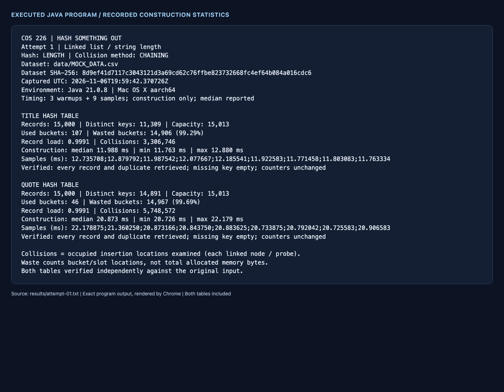

# COS 226: Hash something out

Two custom hash tables store the supplied fake movie records: one uses movie titles
as keys, and the other uses movie quotes. Each experiment is implemented, tested,
measured and committed before the next experiment is added.

## Build, test and run

Requires a JDK 21 or newer. There are no third-party Java dependencies.

```bash
bash scripts/test.sh
bash scripts/run.sh
bash scripts/run.sh --attempt 1 --output build/my-results
bash scripts/run.sh --attempt 1 --title 'Nothing Left to Fear' --quote 'Ergonomic exuding task-force'
```

Run `bash scripts/run.sh --help` for all options. Saved historical evidence lives in
`results/`; use another output directory when collecting new measurements.

## Input and correctness

`data/MOCK_DATA.csv` is the provided input, copied byte for byte. It contains 15,000
records, 11,309 distinct titles and 14,891 distinct quotes. Its SHA-256 is
`8d9ef41d7117c3043121d3a69cd62c76ffbe823732668fc4ef64b084a016cdc6`.
CSV parsing supports quoted commas, doubled quotes, multiline quoted fields,
Unicode, a BOM, trailing empty fields and common line endings. Empty keys are valid;
whitespace and case are preserved. Malformed records produce an actionable error.

Both tables are **multimaps**: each row is stored separately, and `getAll(key)` returns
every matching record in input order. Duplicate titles and quotes are not discarded.
Every experiment verifies all input records against an independent Java `HashMap`
oracle outside the construction timer. The custom tables do not use library maps
for their own storage. Lookups also check a missing key and preserve insertion counters.

## Measurement definitions

- A collision is **each occupied location examined during insertion**. Linked-list
  insertion walks to the tail and counts every existing node. Linear probing counts
  each occupied array slot inspected. Duplicate-key records count in the same way.
- Wasted space is the number and percentage of unused bucket references or array
  slots. Linked nodes and object overhead are additional memory; these counts do
  not claim to measure total bytes.
- Capacity is chosen from the number of records, before timing. Actual array/node
  allocation, hashing and insertion are timed with `System.nanoTime()`; CSV loading,
  verification, printing and file output are excluded.
- Each table receives three warmup builds and nine measured builds in a single JVM.
  The median, minimum, maximum and all samples are retained. Timing varies with JVM
  compilation, allocation, garbage collection and machine activity; deterministic
  collision and waste counts provide the stronger comparison.

## Experiments and reflection

### 1. Linked list with length-only hashing

Length is a deliberately weak starting point because it ignores every character's
value and order. With 15,013 buckets, titles occupy only 107 buckets and quotes only
46. The tables waste 14,906 (99.29%) and 14,967 (99.69%) buckets, respectively.
Tail insertion causes 3,306,746 title collisions and 5,748,572 quote collisions.
Median construction takes 11.988 ms for titles and 20.873 ms for quotes.
The larger quote collision count agrees with its slower construction, despite
length itself being cheap to compute. Increasing capacity alone cannot separate
different keys with identical lengths.

[Raw output](results/attempt-01.txt) · [CSV and samples](results/attempt-01.csv) ·
[Source/evidence hashes](results/attempt-01-manifest.json)



## Tests and evidence

The regression runner checks exact small-case collision counts, duplicate retrieval,
empty keys and datasets, negative hashes including `Long.MIN_VALUE`, malformed CSV,
Unicode, very long strings, deterministic randomized data and the entire supplied
dataset. Compilation treats all Java warnings as errors. GitHub Actions runs the
same tests and rebuilds the experiments on Linux.

For each attempt, the committed evidence includes raw program output, CSV timing
samples, a test log, source/data/evidence SHA-256 hashes, and one combined screenshot
showing both tables. Screenshots are actual headless Chrome captures of the unchanged
Java text output, rendered by `python3 scripts/capture_results.py N`.
